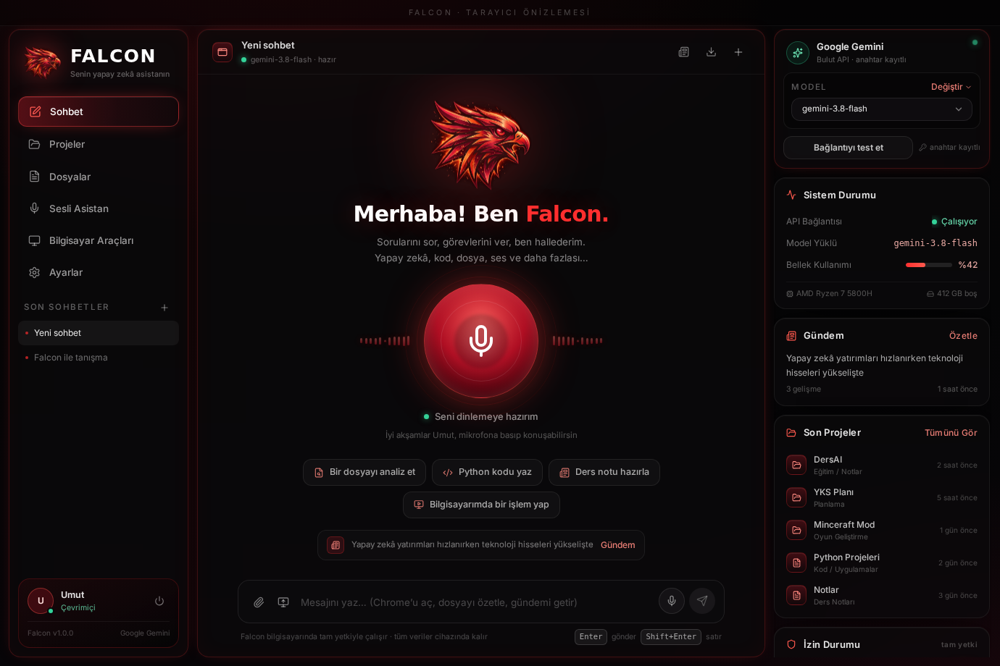
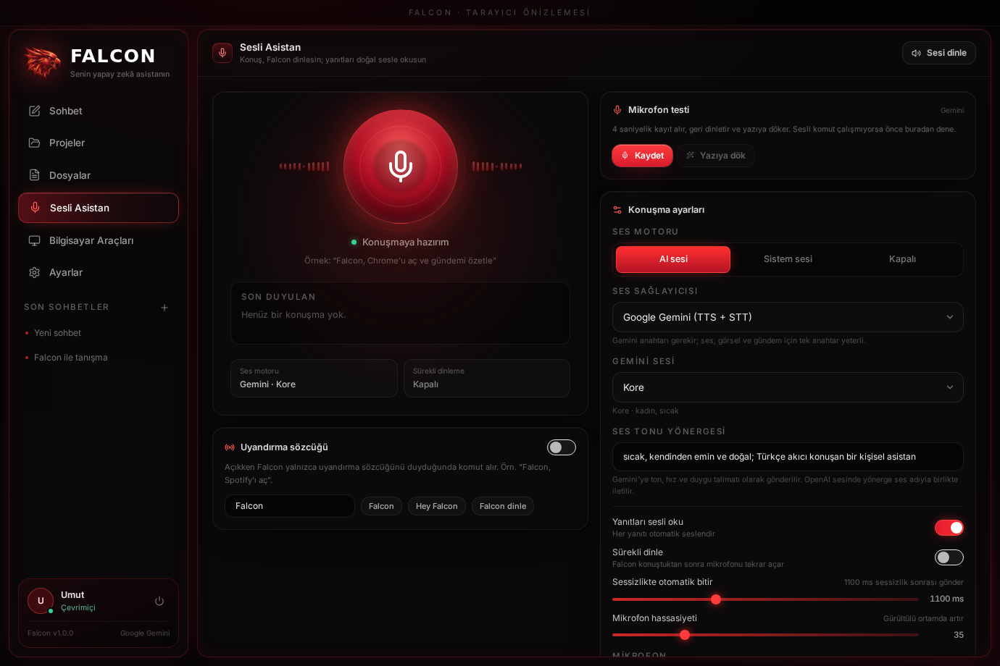
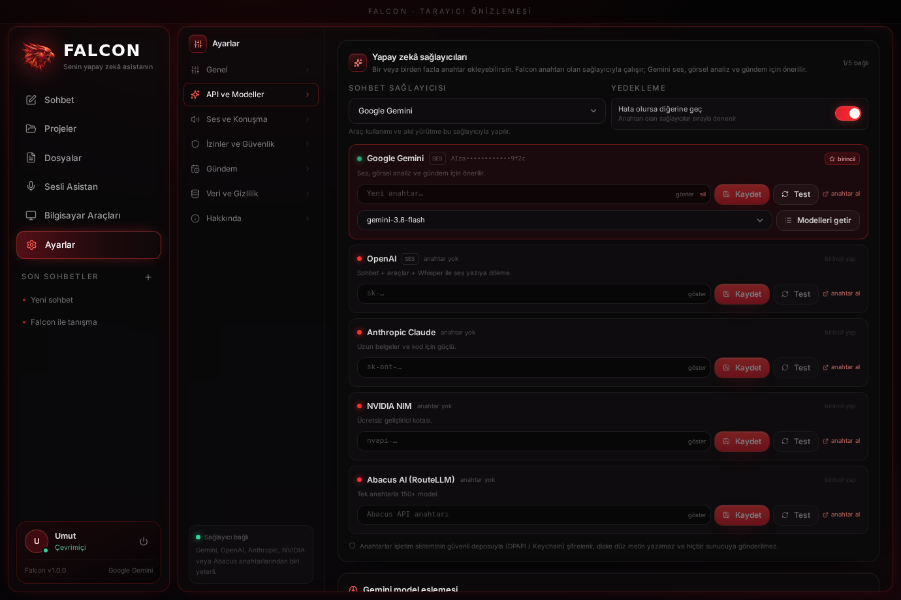
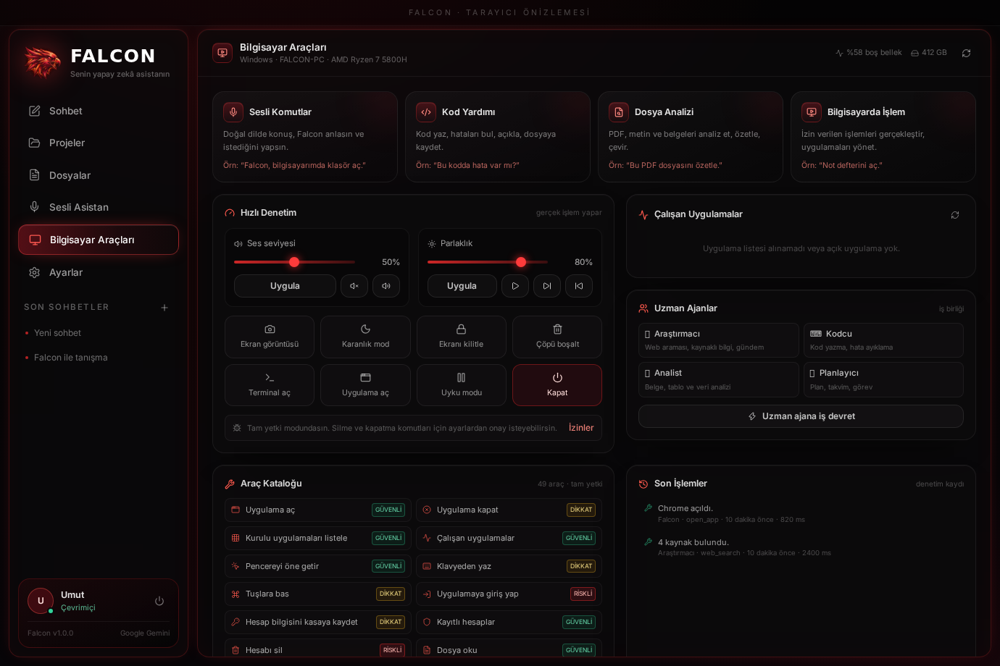
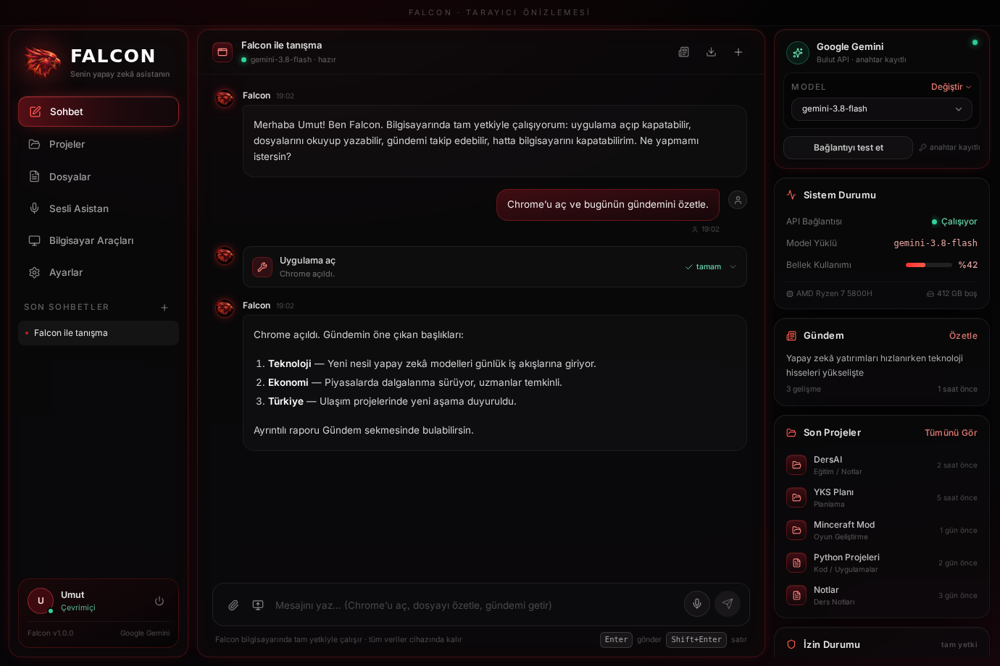

# 🦅 FALCON AI

**Bilgisayarında tam yetkiyle çalışan, seninle konuşan, Türkçe sesli yapay zekâ ajanı.**

Tarayıcıda açılan bir web sitesi değil; Windows / macOS / Linux için gerçek bir masaüstü uygulaması.
Uygulama açar, kapatır, dosya okur yazır, terminal komutu çalıştırır, ekranını analiz eder, senin yerine
gündemi takip eder ve istediğinde **bilgisayarı kapatır**. Tek bir anahtarla çalışır:
**Google Gemini**, **OpenAI**, **Anthropic Claude**, **NVIDIA NIM** veya **Abacus AI (RouteLLM)** — hangisini istersen.

<p align="center">
  
</p>

> Tasarım referansı birebir uygulandı: kırmızı-siyah cam paneller, dev mikrofon orbu, sistem durumu,
> son projeler, izin durumu, sesli asistan penceresi ve bilgisayar araçları.
> Tüm ekranların görselleri: **[docs/GENEL-BAKIS.md](docs/GENEL-BAKIS.md)**

---

## İçindekiler

- [Ne yapar?](#ne-yapar)
- [Hızlı başlangıç](#hızlı-başlangıç)
- [Sağlayıcılar ve API anahtarları](#sağlayıcılar-ve-api-anahtarları)
- [İlk kullanım](#ilk-kullanım)
- [Sesli komut örnekleri](#sesli-komut-örnekleri)
- [Yetenekler (araçlar)](#yetenekler-araçlar)
- [Uzman ajanlar (iş birliği)](#uzman-ajanlar-iş-birliği)
- [İzinler ve güvenlik](#i̇zinler-ve-güvenlik)
- [Veri ve gizlilik](#veri-ve-gizlilik)
- [Mimari](#mimari)
- [Komutlar](#komutlar)
- [Testler](#testler)
- [Kurulum paketi üretme](#kurulum-paketi-üretme)
- [Sorun giderme](#sorun-giderme)
- [SSS](#sss)
- [Yol haritası](#yol-haritası)

---

## Ne yapar?

| Yetenek | Açıklama |
| --- | --- |
| 🎙️ **Sesli asistan** | Mikrofona bas, doğal Türkçe konuş. Falcon sesini **Gemini** veya **OpenAI Whisper** ile yazıya döker, yanıtı **Gemini TTS** ya da **OpenAI gpt-4o-mini-tts** ile seslendirir. Konuşurken sözünü kesebilirsin. |
| 🖥️ **Uygulama aç / kapat** | “Chrome’u aç”, “Spotify’ı kapat”, “VS Code’u öne getir”. Takma adlar Türkçe: *tarayıcı, not defteri, hesap makinesi, gezgin…* |
| ⌨️ **Klavye & otomatik giriş** | Uygulamaya metin yazar, kısayol tuşlarına basar, kasadaki hesapla **otomatik giriş** yapar (şifreyi model görmez). |
| 📄 **Dosya zekâsı** | PDF/DOCX/TXT/CSV okur, özetler, soruları yanıtlar, çevirir, yeni dosya yazar. Taranmış PDF ve görselleri Gemini görsel modeliyle analiz eder. |
| 🖼️ **Ekran analizi** | Ekran görüntüsü alır, “bu ekranda ne var / bu hatayı çöz” gibi soruları yanıtlar. |
| 🧠 **Akıl yürütme + araç kullanımı** | Seçtiğin sağlayıcının function-calling’i ile gerçek işlem yapar; **49 araç**, çok adımlı görev zinciri, sağlayıcı yedekleme. |
| 📰 **Gündem takibi** | Google Arama destekli Gemini ile konularını (Türkiye, dünya, teknoloji, ekonomi…) her gün seçtiğin saatte toplar, sesli özetler. |
| 🗓️ **Görev & hatırlatıcı** | Yapılacaklar listesi, zamanlanmış hatırlatıcılar, masaüstü bildirimi + sesli anons. |
| 🤝 **Uzman ajanlar** | Araştırmacı, Kodcu, Analist, Planlayıcı alt ajanlarına iş devreder, sonuçları tek yanıtta birleştirir. |
| ⚡ **Sistem denetimi** | Ses seviyesi, parlaklık, tema, medya kontrolü, pano, çöp kutusu. |
| 🔌 **Güç işlemleri** | Kapat, yeniden başlat, uyku, ekran kilidi, oturum kapatma — gecikmeli ve iptal edilebilir. |
| 🧾 **Denetim kaydı** | Hangi araç, ne zaman, hangi sonuçla çalıştı — değiştirilemez JSONL günlüğü. |

<p align="center">
  
</p>

---

## Hızlı başlangıç

### Gereksinimler

- **Node.js 22+** ve npm
- Windows 10/11, macOS 13+ veya Linux (X11/Wayland)
- Bir **yapay zekâ API anahtarı**: Gemini (ücretsiz kota), OpenAI, Anthropic, NVIDIA NIM veya Abacus AI

### Geliştirme modunda çalıştırma

```bash
npm install
npm run dev          # Vite + Electron (hot reload)
```

### Derleyip çalıştırma

```bash
npm start            # main/preload + renderer derler, uygulamayı açar
```

### Yalnızca arayüzü önizleme (Electron olmadan)

```bash
npm run preview      # http://localhost:4173 — demo veriyle çalışır
```

> Tarayıcı önizlemesi **sadece tasarım içindir**: gerçek uygulama açma, dosya yazma veya ses
> özellikleri yalnızca masaüstü uygulamasında çalışır.

---

## Sağlayıcılar ve API anahtarları

Falcon beş sağlayıcıyla çalışır. **Bir tanesi yeterlidir**; anahtarı olan diğerleri yedek olarak sırayla denenir.

| Sağlayıcı | Anahtar | Varsayılan model | Ses (TTS/STT) | Not |
| --- | --- | --- | --- | --- |
| **Google Gemini** | [aistudio.google.com/apikey](https://aistudio.google.com/apikey) · `AIza…` | `gemini-3.8-flash` | ✅ Gemini TTS + STT | Görsel analiz, Google Arama destekli gündem |
| **OpenAI** | [platform.openai.com/api-keys](https://platform.openai.com/api-keys) · `sk-…` | `gpt-5.6` | ✅ gpt-4o-mini-tts + Whisper | Sohbet, araç kullanımı, ses |
| **Anthropic** | [console.anthropic.com](https://console.anthropic.com/settings/keys) · `sk-ant-…` | `claude-sonnet-5-5` | — | Uzun belgeler, kod |
| **NVIDIA NIM** | [build.nvidia.com](https://build.nvidia.com) · `nvapi-…` | `meta/llama-3.3-70b-instruct` | — | Ücretsiz geliştirici kotası, `üretici/model` adları |
| **Abacus AI (RouteLLM)** | [abacus.ai/help/route-llm](https://abacus.ai/help/route-llm/) | `route-llm` | — | Tek anahtarla 150+ model, otomatik yönlendirme |

**Kurulum:** Falcon’u aç → **Ayarlar → API ve Modeller** → sağlayıcı kartına anahtarı yapıştır → **Kaydet** →
**Test**. Aynı ekrandan “birincil yap” ile sohbeti taşıyabilir, modeli değiştirebilir veya “Modelleri getir” ile
hesabındaki gerçek model listesini çekebilirsin. İlk kurulum ekranı da sağlayıcı seçtirir.

- **Ses sağlayıcısı** ayrı seçilir: Ayarlar → Ses ve Konuşma → *Ses sağlayıcısı* (Gemini veya OpenAI).
  Ses özellikleri için bu iki sağlayıcıdan birinin anahtarı gerekir; diğerleri sohbet/araç için yeterlidir.
- Anahtarlar işletim sisteminin güvenli deposuyla (**DPAPI / macOS Keychain / libsecret**) şifrelenir;
  `config.json` içinde düz metin **tutulmaz**, hiçbir Falcon sunucusuna gönderilmez.
- Model adları hesabında etkin modellere göre otomatik uyarlanır: model yoksa sağlayıcının yedek modelleri denenir,
  o da yoksa anahtarı olan sıradaki sağlayıcıya geçilir.

<p align="center">
  
</p>

---

## İlk kullanım

| Adım | Ne olur |
| --- | --- |
| 1 | **Adın** sorulur; Falcon sana adınla hitap eder. |
| 2 | **Sağlayıcı seçilir** (Gemini / OpenAI / Anthropic / NVIDIA / Abacus), anahtar girilir ve bağlantı test edilir. |
| 3 | **Yetki seviyesi** seçilir (tam yetki / akıllı / her işlemde sor). |
| 4 | **Ses** seçilir (Gemini sesi: Kore, Puck, Charon… / sistem sesi / sessiz). |

**Mikrofon testi:** Ayarlar → Ses ve Konuşma → **Mikrofon testi** dört saniyelik kayıt alır, geri dinletir,
ses seviyesini gösterir ve yazıya döker. Sesli komut çalışmadığında sorunun mikrofon, izin, ağ veya anahtar
kaynaklı olduğunu buradan ayırt edebilirsin.

**Mikrofon izni:** İlk mikrofon kullanımında işletim sistemi izin ister.

- **Windows:** Ayarlar → Gizlilik ve güvenlik → Mikrofon → *Masaüstü uygulamalarının erişmesine izin ver*
- **macOS:** Sistem Ayarları → Gizlilik ve Güvenlik → Mikrofon → Falcon
- **Windows’ta klavye kontrolü/otomatik giriş:** PowerShell betikleri kullanılır; yönetici yetkisi gerekmez.

---

## Sesli komut örnekleri

```
“Falcon, Chrome’u aç.”
“Spotify’ı kapat.”
“Bugünün gündemini özetle ve kaydet.”
“Masaüstünde ‘Projeler’ klasörü aç, içine not defteriyle bir plan yaz.”   ← çok adımlı
“Bu PDF’i oku, ana fikirleri çıkar ve İngilizceye çevir.”
“Ekranda ne var? Bu hata ne anlama geliyor?”
“Gmail’e giriş yap.”                        → kasadaki hesapla otomatik giriş
“Sesi yüzde otuza indir, ekranı kilitle.”
“Yarın 09:00’da annemi aramamı hatırlat.”
“Bilgisayarı 5 dakika sonra kapat.”
“Bunu hatırla: toplantılarımı sabah 10’dan önce koymamayı tercih ediyorum.”
```

> **Klavye kısayolları:** `Ctrl/Cmd + Alt + Space` → Falcon’u öne getir + mikrofon,
> `Ctrl/Cmd + Shift + M` → mikrofon, `Ctrl/Cmd + Alt + F` → **acil durdurma** (tüm işlemleri keser).

---

## Yetenekler (araçlar)

Falcon’un modeli bu araçları kendi seçer ve gerçekten çalıştırır. Tüm çağrılar denetim kaydına yazılır.

| Grup | Araçlar |
| --- | --- |
| **Uygulamalar** | `open_app`, `close_app`, `list_apps`, `list_running_apps`, `activate_window`, `type_text`, `press_keys`, `login_app`, `save_credential`, `list_credentials`, `delete_credential` |
| **Dosya** | `read_file`, `write_file`, `append_file`, `list_directory`, `search_files`, `copy_path`, `make_directory`, `delete_path`, `open_path`, `analyze_document`, `translate_file`, `save_note` |
| **Sistem** | `system_info`, `system_power`, `set_volume`, `set_muted`, `media_control`, `set_brightness`, `toggle_dark_mode`, `empty_trash`, `capture_screen`, `read_clipboard`, `write_clipboard`, `open_url`, `notify_user`, `run_command` |
| **Bilgi & hafıza** | `web_search`, `news_digest`, `remember`, `recall`, `add_task`, `list_tasks`, `complete_task`, `add_reminder`, `list_reminders`, `create_project`, `list_projects`, `delegate_task` |

Her araç için risk seviyesi bellidir: `güvenli`, `dikkat`, `riskli`. Onay modu bu seviyeye göre çalışır.

---

## Uzman ajanlar (iş birliği)

Falcon karmaşık görevlerde işi uzman bir **alt ajana** devreder; her ajanın kendi sistem istemi ve
kendi araç seti vardır:

| Ajan | Uzmanlık | Örnek görev |
| --- | --- | --- |
| 🔎 **Araştırmacı** | Google Arama, kaynaklı bilgi, gündem | “Son 24 saatte yapay zekâ alanında ne oldu?” |
| ⌨️ **Kodcu** | Kod yazma, hata ayıklama, dosya düzenleme | “Bu Python betiğini düzelt ve çalıştır.” |
| 📊 **Analist** | Belge, tablo, görsel analizi | “Bu 40 sayfalık raporun yönetici özetini çıkar.” |
| 🗺️ **Planlayıcı** | Plan, görev, takvim, hatırlatıcı | “YKS için 8 haftalık plan yap ve görevlere ekle.” |

<p align="center">
  
</p>

---

## İzinler ve güvenlik

Falcon **tam yetkiyle** çalışacak şekilde tasarlandı ama asla kontrolsüz değil.

| Mod | Davranış |
| --- | --- |
| **Tam yetki** | Çoğu işlemi sormadan yapar. Yalnızca ayarlarda işaretlersen silme/terminal/kapatma için onay ister. |
| **Akıllı** | Riskli işlemlerde (silme, terminal, güç, otomatik giriş) onay ister. |
| **Her işlemde sor** | Her araç çağrısı için onay kutusu (geri sayım ile). |

Ek korumalar:

- **Kara liste:** `rm -rf /`, `format`, `mkfs`, `diskpart clean`, `vssadmin delete`, `bcdedit` gibi yıkıcı komutlar engellenir.
- **Korunan klasörler:** `C:\Windows`, `C:\Program Files`, `/etc`, `/usr`, `/System`… buraya **yazma** reddedilir.
- **İzin verilen kökler:** Varsayılan olarak kullanıcı ev dizini. İstediğin klasörleri Ayarlar → İzinler’den ekleyebilirsin.
- **Çöp kutusu:** Silme işlemleri kalıcı değil, `delete_path` çöp kutusuna taşır.
- **Şifreli kasa:** Hesap şifreleri işletim sistemi kasasında; model yalnızca “hesap adı”nı görür.
- **Acil durdurma:** `Ctrl/Cmd + Alt + F` veya tepsi menüsü → tüm araç çağrıları anında kesilir.
- **Denetim kaydı:** Her araç çağrısı `audit.jsonl` dosyasına yazılır (Bilgisayar Araçları → Son İşlemler).

---

## Veri ve gizlilik

Her şey **cihazında** kalır. Falcon’un kendi sunucusu yoktur; yalnızca senin anahtarınla **seçtiğin sağlayıcının API’sine**
(Gemini, OpenAI, Anthropic, NVIDIA veya Abacus) istek gider.

```
Windows: %APPDATA%\Falcon AI\falcon-data\
macOS:   ~/Library/Application Support/Falcon AI/falcon-data/
Linux:   ~/.config/Falcon AI/falcon-data/
├── config.json        # ayarlar (API anahtarı şifreli)
├── chats.json         # sohbetler
├── projects.json      # projeler
├── tasks.json         # görevler
├── reminders.json     # hatırlatıcılar
├── memories.json      # hafıza
├── files.json         # dosya dizini
├── agenda.json        # gündem özetleri
├── delegations.json   # alt ajan kayıtları
├── vault.json         # şifreli hesap kasası
├── audit.jsonl        # denetim kaydı
├── screenshots/       # ekran görüntüleri
└── logs/              # günlükler
```

Ayarlar → **Veri ve Gizlilik** bölümünden tek tıkla **yedek al**, yedekten geri yükle veya sıfırla.

---

## Mimari

```
├── electron/                 # ana süreç (Node, tam sistem yetkisi)
│   ├── main.ts               # pencere, tepsi, kısayollar, IPC, izinler, app:// protokolü
│   ├── preload.ts            # güvenli köprü (contextIsolation, sandbox)
│   ├── core/
│   │   ├── llm.ts            # sağlayıcı yönlendirici (Gemini / OpenAI / Anthropic / NVIDIA / Abacus)
│   │   ├── provider-specs.ts # sağlayıcı tanımları, modeller, anahtar ipuçları
│   │   ├── gemini.ts         # Gemini istemcisi: akış, araç çağrısı, TTS, STT, arama
│   │   ├── agent.ts          # ajan döngüsü (düşün → araç → gözlem → yanıt)
│   │   ├── config.ts         # ayarlar + safeStorage ile anahtar şifreleme
│   │   ├── secrets.ts        # anahtar şifreleme/maskeleme
│   │   ├── security.ts       # izin modu, onay, kara liste, yol koruması
│   │   ├── db.ts / store.ts  # yerel JSON veri katmanı (atomik yazma)
│   │   └── vault.ts          # şifreli kimlik bilgisi kasası
│   └── services/
│       ├── tools.ts          # 49 araç tanımı ve yürütücüsü
│       ├── apps.ts           # uygulama aç/kapat/listele (win/mac/linux)
│       ├── documents.ts      # PDF / DOCX / metin çıkarma, dosya işlemleri
│       ├── system.ts         # güç, ses, parlaklık, ekran görüntüsü, pano
│       ├── voice.ts          # TTS/STT hattı (Gemini + OpenAI, WAV birleştirme)
│       ├── delegation.ts     # uzman alt ajanlar
│       ├── agenda.ts         # gündem toplama ve sesli özet
│       ├── scheduler.ts      # hatırlatıcılar + günlük gündem
│       └── models.ts         # hesaptaki modellere otomatik uyarlama
├── src/                      # arayüz (React + TypeScript + Tailwind)
│   ├── views/                # Sohbet, Projeler, Dosyalar, Ses, Araçlar, Ayarlar
│   ├── components/           # orb, mesajlar, onay, panel, toast…
│   └── lib/                  # store (zustand), ses motoru, demo API
├── shared/types.ts           # iki taraf arasında paylaşılan tipler
└── tests/                    # arka uç entegrasyon testi + tarayıcı görüntüleme
```

**İstek akışı**

```
Mikrofon → WAV → Gemini/OpenAI (STT) → ajan döngüsü
                                   ├─ seçili sağlayıcıda stream (function calling)
                                   ├─ araç yürütme (izin + onay + denetim)
                                   └─ gözlem → modele geri besleme
Yanıt → arayüz (akış) → Gemini/OpenAI TTS (WAV) → hoparlör
```

---

## Komutlar

| Komut | Açıklama |
| --- | --- |
| `npm run dev` | Geliştirme: Vite + Electron (hot reload) |
| `npm start` | Derle ve çalıştır |
| `npm run build` | Electron + arayüz derlemesi (`dist/`, `dist-electron/`) |
| `npm run typecheck` | TypeScript denetimi (iki taraf) |
| `npm run test:backend` | Derle + arka uç entegrasyon testi (84 test) |
| `npm run preview` | Tarayıcıda arayüz önizlemesi (demo veri) |
| `npm run dist` | Geçerli platform için kurulum paketi |
| `npm run dist:win` / `dist:mac` / `dist:linux` | Platforma özel paket (`release/`) |

---

## Testler

```bash
npm run test:backend
```

Gerçek ana süreç kodunu ekran/GPU olmadan çalıştırır; Electron ve **beş sağlayıcının API’si** taklit edilir
(`tests/harness/gemini-mock.cjs`) ve şunlar sınanır: ayar şifreleme, sağlayıcı anahtarları ve maskeleme,
OpenAI/Anthropic/NVIDIA/Abacus istemcileri, model keşfi, bağlantı testi, **ajan araç döngüsü**, TTS (geçerli WAV),
Whisper STT, **app:// protokolü** (SPA yönlendirme + dizin dışına çıkış koruması), dosya yazma/okuma/arama,
**kara liste engeli**, **sistem klasörü koruması**, **onay akışı**, veri katmanı, gündem ve uzman ajanlar.

```
84/84 test geçti
```

<p align="center">
  
</p>

---

## Kurulum paketi üretme

```bash
npm run dist:win      # Windows: NSIS kurulum .exe  → release/
npm run dist:mac      # macOS: .dmg (x64 + arm64)
npm run dist:linux    # Linux: AppImage + .deb
```

> **Not:** Windows kurulum dosyasının kendi makinende üretilmesi en sağlıklısıdır (`npm run dist:win`).
> macOS imzası için Apple Developer sertifikası gerekir (imzasız da çalışır, ilk açılışta
> “Sağ tık → Aç” gerekebilir).

Paketlenen uygulama `build/icon.png` (1024×1024) ve tepsi simgesi `assets/falcon-mark.png` kullanır.

---

## Sorun giderme

| Belirti | Çözüm |
| --- | --- |
| “Bağlantı kurulamadı · API key not valid” | Anahtarı yeniden gir; doğru sağlayıcı kartına yapıştırdığından ve anahtarın o API’de etkin olduğundan emin ol. |
| `429 RATE_LIMITED` | Dakikalık/günlük kota. Birkaç saniye bekle veya Ayarlar’dan `flash-lite` modeline geç. |
| “Model bulunamadı” | Falcon otomatik olarak hesabındaki en yakın modele geçer; Ayarlar → API ve Modeller’den elle de seçebilirsin. |
| Ses çıkmıyor | Ayarlar → Ses: ses motoru *AI sesi*, “Yanıtları sesli oku” açık mı? Ses sağlayıcısının anahtarı var mı? Sistem ses çıkışı açık mı? |
| **Sesli komut çalışmıyor** | Ayarlar → Ses ve Konuşma → **Mikrofon testi**: kaydı dinle ve “Yazıya dök”. Kayıt sessizse cihaz/izin; kayıt iyiyse anahtar veya internet sorunudur. Ses sağlayıcısı Gemini ise Gemini anahtarı, OpenAI ise OpenAI anahtarı gerekir. |
| Mikrofon açılmıyor | Windows/macOS gizlilik ayarlarından Falcon’a mikrofon izni ver; cihazı Ses sayfasından seç. |
| Uygulama beyaz ekran açılıyor | Geliştirme yapıyorsan `npm run build` ile `dist/` klasörünü üret; paketlenmiş uygulama `app://falcon/index.html` üzerinden yüklenir. |
| “Uygulama bulunamadı” | Kurulu uygulamaları Falcon’a listelet: “yüklü uygulamaları listele”. Alternatif olarak tam yol ver. |
| Klavye yazmıyor (macOS) | Sistem Ayarları → Gizlilik → **Erişilebilirlik** → Falcon’u ekle. |
| Linux’ta medya tuşları | `sudo apt install playerctl` |
| Linux’ta pencere öne alma | `sudo apt install wmctrl xdotool` veya Wayland’de `ydotool` |
| Acil durdurma | `Ctrl/Cmd + Alt + F` veya tepsi → *Acil durdurma*. |

---

## SSS

**Neden tarayıcı değil?**
Çünkü tarayıcı sayfası uygulama açamaz, terminal çalıştıramaz, bilgisayarı kapatamaz. Falcon bir
Electron masaüstü uygulamasıdır; işletim sistemiyle doğrudan konuşur.

**Hangi sağlayıcıyı seçmeliyim?**
Ses, görsel analiz ve Google Arama destekli gündem istiyorsan **Gemini** (ücretsiz kota) en pratik seçenek.
Araç kullanımı ve kod için **OpenAI** veya **Anthropic**, ücretsiz deneme için **NVIDIA NIM**, tek anahtarla
çok model için **Abacus RouteLLM** iyi çalışır. Birden fazla anahtar ekleyebilirsin; Falcon birincil sağlayıcı
hata verirse diğerine geçer.

**Maliyeti nedir?**
Gemini API’nin ücretsiz kotası günlük kullanım için genelde yeterlidir; NVIDIA NIM’in geliştirici kotası da ücretsizdir.
TTS ve uzun belgeler daha çok token harcar; Ayarlar’dan daha küçük modellere geçerek maliyeti düşürebilirsin.

**Şifrelerim güvende mi?**
Evet. Şifreler işletim sistemi kasasında şifrelenir; model yalnızca hesap adını bilir. “Giriş yap”
işlemini yerel araç yapar, şifre hiçbir zaman sohbet metnine yazılmaz.

**İnternet olmadan çalışır mı?**
Yerel işlemler (dosya, uygulama, güç) çalışır; yapay zekâ yanıtları için internet gerekir.

---

## Yol haritası

- [ ] Yerel görsel/OCR için isteğe bağlı çevrimdışı yedek model
- [ ] Takvim (Google Calendar ICS) entegrasyonu
- [ ] Çoklu pencere / ikinci ekran modu
- [ ] Eklenti (skill) mağazası: kullanıcı tanımlı araçlar
- [ ] Sesli uyandırma sözcüğünün tamamen çevrimdışı algılanması

---

## Lisans

MIT © Umut Demirel

> Falcon, hiçbir sağlayıcının resmî ürünü değildir. “Gemini” ve “Google AI”, Google LLC’nin; “OpenAI”, “ChatGPT” ve
> “Whisper”, OpenAI’nin; “Claude”, Anthropic’in; “NVIDIA NIM”, NVIDIA’nın; “Abacus AI”, Abacus.AI’nin ticari markalarıdır.
