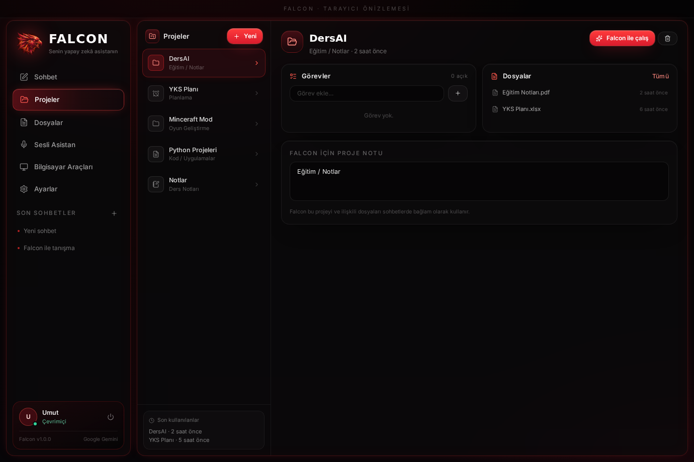
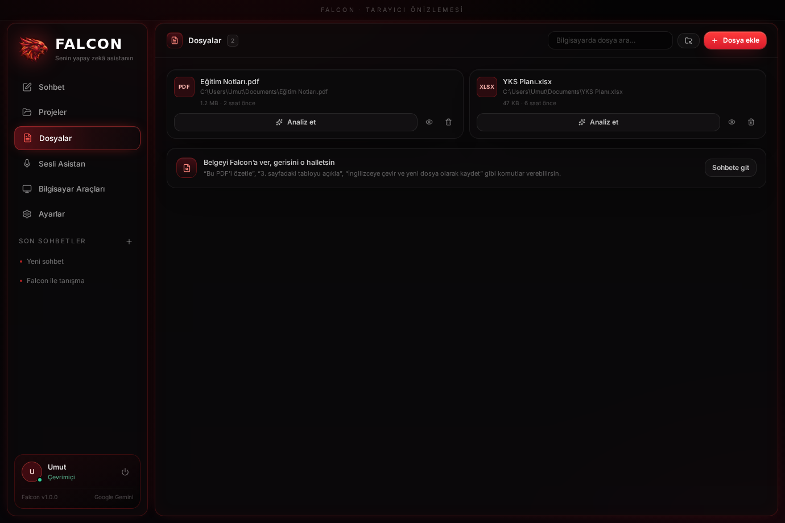
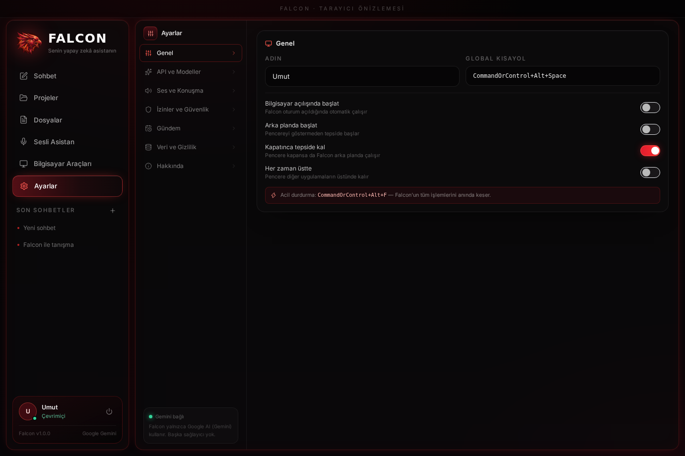
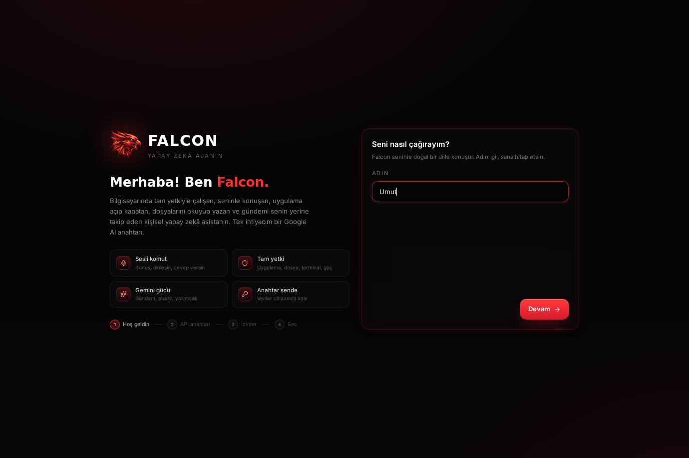

# Falcon AI — Genel Bakış

Falcon, bilgisayarında **tam yetkiyle** çalışan Türkçe sesli yapay zekâ ajanıdır.
Electron tabanlı gerçek bir masaüstü uygulamasıdır; tarayıcıda açılan bir site değildir.
Tek ihtiyacı bir **Google AI (Gemini) API anahtarı**dır.

Bu sayfa uygulamanın tüm ekranlarını gösterir. Kurulum ve kullanım için [README](../README.md).

---

## Ana ekran — Sohbet

Kırmızı-siyah cam paneller, dev mikrofon orbu (dalga formu animasyonu), öneri kartları, mesaj girişi.
Sağ sütunda model/sağlayıcı kartı, **Sistem Durumu**, **Son Projeler** ve **İzin Durumu**.


---

## Sohbet görünümü

Akış yanıtları, araç çağrısı kartları (hangi araç, hangi parametre, sonuç), Markdown biçimlendirme,
kod blokları, konuşma geçmişi.


---

## Sesli asistan

Yüzen ses paneli: canlı dalga formu, mikrofon durumu, sessize alma, konuşmayı kesme.
Yanıtlar Gemini TTS ile seslendirilir; “Dinliyorum…” göstergesi panel kapalıyken de görünür.


---

## Bilgisayar araçları

49 aracın kataloğu, risk seviyeleri ve son işlemlerin **denetim kaydı**.
Her satırda ne çalıştı, ne zaman çalıştı ve sonucu görünür.


---

## Projeler

Proje kartları, durum etiketi, ilerleme ve proje notları (otomatik kaydedilir).
Falcon “yeni proje oluştur” dediğinde buraya ekler.



---

## Dosyalar

Bilgisayarındaki dosyaların dizini: son açılanlar, tür ikonları, boyut ve yol bilgisi.
Falcon’a “bu dosyayı özetle” dediğinde analiz burada listelenen dosyalar üzerinden yapılır.



---

## Ayarlar

Yedi sekme: **Genel**, **API ve Modeller**, **Ses ve Konuşma**, **İzinler ve Güvenlik**,
**Gündem**, **Veri ve Gizlilik**, **Hakkında**.



---

## Kurulum (onboarding)

İlk açılışta dört adım: adın → API anahtarı (test ile) → yetki seviyesi → ses motoru ve ses seçimi.



---

## Teknik özet

| | |
| --- | --- |
| Masaüstü çatısı | Electron 45 (contextIsolation + sandbox) |
| Arayüz | React 19, TypeScript 5.9, Vite 8, Tailwind 3.4, Zustand 5 |
| Yapay zekâ | Google Gemini (`generateContent` akışı, function calling, TTS, STT, Google Arama) |
| Anahtar saklama | İşletim sistemi kasası (DPAPI / Keychain), diskte `enc:` önekli şifreli |
| Veri | Yerel JSON deposu + değiştirilemez `audit.jsonl` denetim kaydı |
| Paketleme | electron-builder → NSIS (.exe), DMG (.dmg), AppImage + .deb |
| Test | 51 arka uç entegrasyon testi (Electron + Gemini taklit edilerek) |

### İstek akışı

```
Mikrofon → WAV → Gemini STT → ajan döngüsü (en fazla 24 araç adımı)
                                 ├─ Gemini akışı (function calling)
                                 ├─ izin kontrolü → onay → araç yürütme → denetim kaydı
                                 └─ gözlem modele geri beslenir
Yanıt → arayüz (akış) → Gemini TTS → hoparlör
```

### Güvenlik modeli

- Üç izin modu: **tam yetki**, **akıllı**, **her işlemde sor**.
- Yıkıcı terminal komutları kara listede; sistem klasörlerine yazma reddedilir.
- Silme işlemleri çöp kutusuna gider.
- Şifreler modelden gizli; giriş işlemi yerel araçta yapılır.
- `Ctrl/Cmd + Alt + F` her şeyi anında durdurur.
